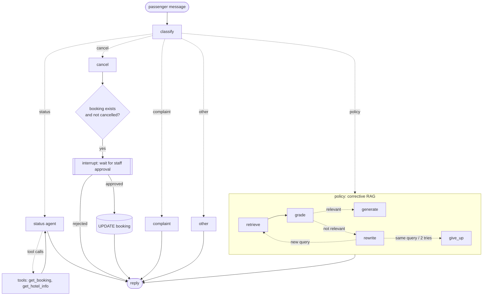

# TransitDesk

**An AI support agent for an airline's transit-hotel desk, built with LangGraph.**

A passenger writes a message. TransitDesk works out what they need, looks up their booking with tools, answers policy questions from documents (and corrects its own search when results are poor), remembers the conversation, and **pauses for a staff member's approval before cancelling anything**. Every behaviour is measured on a labelled test set.

> All data is fictional: bookings, hotels, phone numbers and the policy were written for this demo.

**Live demo:** https://YOUR-PROJECT.vercel.app

     

---

## How it works



| Part | LangGraph concept |
|---|---|
| Classifier routes each message (5 categories) | Structured output (Pydantic) + conditional edges |
| Status agent looks up bookings and hotels | Tool calling, `ToolNode`, the agent loop |
| Policy answers with self-correction | Cycles: grade → rewrite query → retrieve again, with an exit condition |
| Remembers the conversation across restarts | `SqliteSaver` checkpointer, `thread_id` |
| Staff approval before cancelling | `interrupt()` and `Command(resume=...)` |
| Answers stream word by word, over HTTP too | `stream_mode=["updates", "messages"]`, `subgraphs=True`, FastAPI + NDJSON |
| Survives provider outages | Fallback across providers (Groq ↔ Gemini) + node `RetryPolicy` for 429/503 only |
| Web console: chat, bookings and hotels editor, approvals inbox | React 19 + TypeScript (Vite) front end; tool calls and their results are streamed so you can check the agent against the data |
| Runs on Vercel with persistent memory | SQLite locally, Neon Postgres in production (`PostgresSaver`), chosen by `DATABASE_URL` |

---

## Results

### Evaluation (21 labelled cases)

<!-- Paste the output of:  python step8_eval.py --report baseline -->
| Metric | Passed | Rate |
|---|---|---|
| route | _/21 | _% |
| ref | _/9 | _% |
| urgent | _/3 | _% |
| safe_action | _/4 | _% |
| facts | _/14 | _% |
| grounded | _/14 | _% |
| on_topic | _/14 | _% |
| latency | avg _ s | p95 _ s |

- **Deterministic checks**: route, booking reference, urgency, whether cancellations pause with the *right* booking, and required facts in the answer.
- **LLM-as-judge**: `grounded` (every claim is supported by the policy or database) and `on_topic` (nothing the question didn't ask for).

### Improvements measured

| Change | Before | After |
|---|---|---|
| Keyword rules → LLM classifier (5 test tickets) | 1/5 correct | 5/5 correct |
| Gemini, default "high" thinking → Groq gpt-oss-120b, low reasoning | many seconds per call (and 503 errors) | 0.6 s per classification |
| Policy answer prompt: "use only the sections that answer the question" | on_topic _% | on_topic _% |

---

## What testing found, and how I fixed it

Most of the design came from failures found while testing:

1. **The agent asked to cancel the wrong booking.** With two booking references in the conversation, the LLM picked the old one. Human approval caught it. **Fix:** exact identifiers are extracted by code (a regular expression on the latest message); the LLM only decides intent. *Rule: LLMs decide what the user wants; code handles exact values.*
2. **I approved the wrong request myself.** The approval box showed both references, but nothing pointed out the mismatch, so I typed `y` out of habit. **Fix:** a visible warning when the message mentions a different booking, and approval then requires typing the reference. Over the API, approving such a request without `confirm_ref` returns 422.
3. **Overlapping categories.** "How do I get there?" went to *policy* (general rules) instead of *status* (this passenger's hotel). **Fix:** categories are defined by *whose* question it is, not by topic.
4. **No fallback class.** "hi" was forced into *policy*. **Fix:** an `other` category.
5. **The query rewriter copied the prompt.** Listing example policy words made the model paste all of them into the query. **Fix:** 2 to 6 words on the question's topic only; stop early if a rewrite repeats the last query.
6. **Provider outages.** Gemini returned 503 on two models at once. **Fix:** cross-provider fallback behind one `with_backup()` helper; graph-level retries only for temporary errors.
7. **The approvals inbox crashed on a fresh database.** The checkpointer creates its tables only when the first conversation is saved. **Fix:** treat "no tables yet" as "no conversations yet". Evaluation threads are also hidden from the inbox, so nobody can approve a test request and change real data.
8. **Streaming looked broken for policy answers.** The RAG graph runs inside a node. **Fix:** pass the node's `config` to the inner graph and stream with `subgraphs=True`.
9. **Serverless forgets local files.** On Vercel the disk is read-only and temporary, so SQLite would lose bookings, conversations and paused approvals. **Fix:** the same code uses Neon Postgres when `DATABASE_URL` is set, for both data and the LangGraph checkpointer. Tested: an approval requested before a server restart was approved after it.
10. **The evaluation could have wiped production.** It resets the bookings before running. **Fix:** it refuses to run against Postgres unless `--allow-postgres` is given.
11. **Measuring showed streaming helps little here.** Time to first token was almost the total time: the cost is three LLM round trips in the agent loop, not writing the answer.

## Limitations

- **No identity check:** anyone who knows a booking reference can ask to cancel it. Staff approval protects against harm, but a real system should verify the passenger first.
- **Conversation access:** anyone who knows a `thread_id` can read it through `/threads`. IDs are random (64 bits), but production needs them tied to an authenticated user, plus a retention policy for stored conversations.
- **Public demo:** the chat is open to anyone, limited per visitor per hour and per day (visitors are identified by a hash of their IP; IPs are not stored). Cancellation requests from visitors wait until a staff member approves them.
- **Judge bias:** the same model family writes and grades answers; judges also vary between runs.
- **Small test set** (21 cases) and keyword search (BM25) over a short policy; SQLite instead of Postgres.

## Checking the agent against the data

In the web console, each answer has **"What the agent looked up"**, showing the exact tool calls and the database rows they returned, and the booking being discussed is highlighted in the table. To test correctness, change a booking (for example ET-1377 from Confirmed to Pending, or a new pickup time), ask about it again, and check that the answer follows the new data.

## Next steps

- One `get_booking_details` tool that returns the booking *and* its hotel, removing one LLM round trip.
- Postgres checkpointer and pgvector search; a web front end for passengers and a staff approval page.
- A larger test set, written with real desk staff, and a second judge model.

---

## Deploy to Vercel

1. **Database:** in [Neon](https://neon.tech), create a database (a new one, not Ask Getacher's) and copy its **pooled** connection string (the host contains `-pooler`).
2. **Load the demo data into Neon** from your machine:
   ```powershell
   $env:DATABASE_URL="postgresql://...-pooler...neon.tech/transitdesk?sslmode=require"
   python db.py
   Remove-Item Env:DATABASE_URL     # so local runs and the evaluation use SQLite again
   ```
3. **Vercel:** import the GitHub repo at vercel.com/new. Vercel detects FastAPI from `app.py`; no build settings needed.
4. **Environment variables** (Settings → Environment Variables): `DATABASE_URL`, `STAFF_API_KEY`, `GROQ_API_KEY`, `GROQ_MODEL`, `GROQ_REASONING_EFFORT`, `LLM_ORDER`, and if you use Gemini as backup `GOOGLE_API_KEY`, `GEMINI_MODEL`, `THINKING_LEVEL`. Optional: `PUBLIC_READ=true`, `CHAT_LIMIT_PER_HOUR`, `CHAT_LIMIT_PER_DAY`. Then redeploy.
5. **Check:** open `/health`, which should show `"database": "ok", "storage": "postgres"`. Then open the site and chat.

## Front end (React)

```powershell
cd web
npm install
npm run dev        # http://localhost:5173, hot reload; API calls go to FastAPI on port 8000
npm run build      # writes the finished site to ../public  (commit it before deploying)
```

Keep `uvicorn api:app --reload` running in another terminal while using `npm run dev`.

## Run it locally

```bash
python -m venv .venv
.venv\Scripts\activate          # Windows  (macOS/Linux: source .venv/bin/activate)
pip install -r requirements.txt
copy .env.example .env          # then add your keys (leave DATABASE_URL empty locally)
python db.py                    # create the demo database
```

| Command | What it does |
|---|---|
| `uvicorn api:app --reload` | **Web console** at http://127.0.0.1:8000 (enter `STAFF_API_KEY` in the yellow bar) |
| `python step6_desk.py demo` | Chat in the terminal, with staff approval prompts |
| `python step7_stream.py` | See answers stream token by token |
| http://127.0.0.1:8000/docs | API documentation |
| `python client.py t1` | Terminal client for the API |
| `python step8_eval.py --label baseline` | Run the evaluation |
| `python step8_eval.py --compare A B` | Compare two runs |

## Project structure

The project was built step by step; each file adds one LangGraph idea.

| File | Step |
|---|---|
| `step1_graph.py` | State, nodes, edges, reducers (no LLM) |
| `step2_llm.py` | LLM classifier with structured output, compared with keyword rules |
| `step3_agent.py`, `tools.py`, `db.py` | Tool calling and the agent loop |
| `step4_rag.py`, `rag.py`, `policies.md` | Corrective RAG with a rewrite cycle |
| `step5_desk.py` | One combined graph with memory |
| `step6_desk.py` | Human approval with `interrupt()` |
| `step7_stream.py`, `api.py`, `client.py` | Streaming, FastAPI |
| `web/` | React + TypeScript source of the console (`src/components/`: Chat, Bookings, Hotels, Approvals) |
| `public/` | The built console (`npm run build` writes here; served by FastAPI locally and by Vercel's CDN) |
| `app.py` | Vercel entry point (imports the app from `api.py`) |
| `step8_eval.py`, `eval_set.json` | Evaluation |
| `llm.py` | Model providers, fallback and retry policy |

Built by **Getacher Ashebir**.
